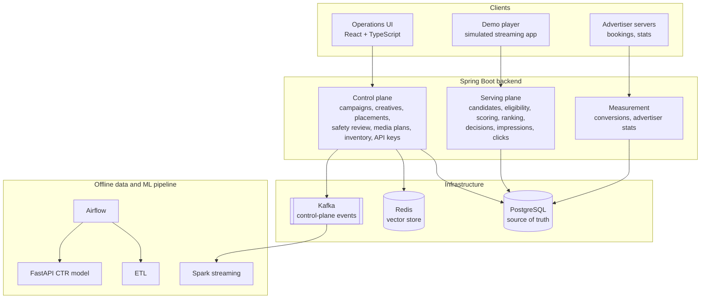
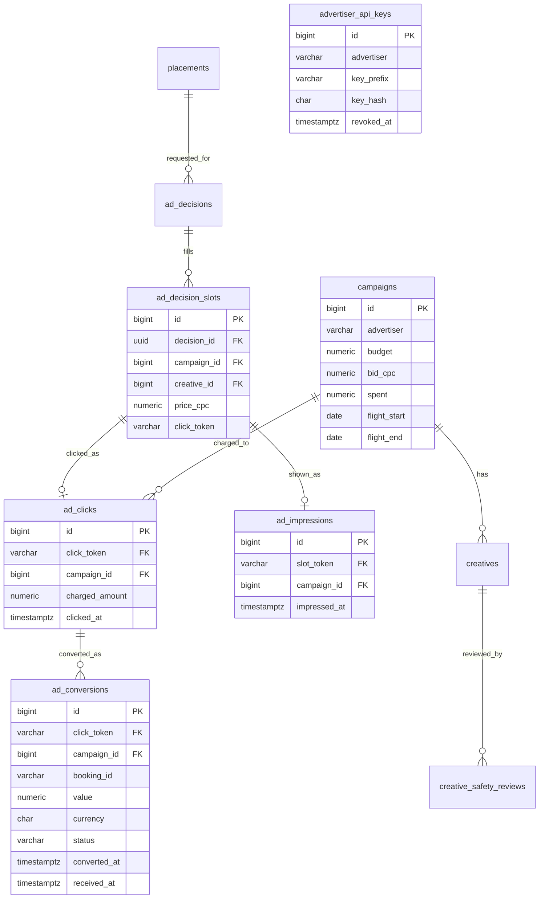

# Architecture

This document describes how the Streaming Ads Platform is put together: the
components, how a request, an impression, a click and a conversion flow through
them, how advertisers authenticate and read their stats, the data model, the
consistency guarantees, and how the design would evolve at scale.

Each section separates what is **built and tested** from what is **designed but
not built yet**.

## 1. System overview



| Plane | Responsibility | Status |
|---|---|---|
| **Control plane** | People configure what may serve: campaigns, creatives, placements, safety review; ops issue advertisers' API keys | Built |
| **Serving plane** | Machines decide which ads serve, count them when they appear, and charge for clicks | Built |
| **Measurement** | Advertisers' servers report bookings; advertisers read their stats | Built |
| **Offline data and ML** | Batch ETL, stream aggregation, model training | Built earlier on a public dataset; not yet connected |

The backend is a single Spring Boot application with clear package boundaries per
domain. The boundaries (ports such as `CandidateSource`, `CtrScoringPort` and
`StatsSource`) are where it would split, or where new implementations plug in.

## 2. Control plane

| Domain | What it holds | Key rules |
|---|---|---|
| **Campaign** | Budget, bid per click, flight dates, targeting | Spend changed only by click tracking; never above budget |
| **Creative** | Type, media, destination, duration | Two gates: `status` (advertiser) and `safetyStatus` (platform) |
| **Placement** | Type, devices, creative types, max ads, max length per ad | Rules inside the entity; new placements start inactive; unique names |
| **Safety review** | Review history per creative | Only an approved creative can serve |
| **Media plan, inventory** | Sales workflow and slot inventory per show | Enforced state transitions |
| **API keys** | Hashed keys per advertiser | Shown once; revocable; issued only for advertisers with campaigns |

Rules live inside the entities where possible. `Placement`, for example, has no
setters: it can only be created or changed through methods that validate everything
first.

## 3. Serving: one ad request

```text
POST /api/v1/ad-decisions
  { placementId: 1, deviceType: TV, showId: show-711,
    audienceSegments: [HOME_IMPROVEMENT], availableSlots: 2 }

1. Validate request          400 if malformed; 404 if the placement does not exist
2. Retrieve candidates       one query: ACTIVE campaigns with a bid and budget for a
                             click, ACTIVE + APPROVED creatives the placement accepts
3. Eligibility rules         status, flight, placement and device fit, creative fit,
                             targeting; first failure gives a reason code
4. Score                     CtrScoringPort, one batch call -> 0.02 (fixed prior)
5. Rank                      bid x CTR = 1.50 x 0.02 = 0.03, one per campaign
6. Fill and record           decision + slots, price per slot, random slot token
7. Respond                   media URL, impression URL, click URL; no destination
```

Design choices: hard rules before scoring; retrieval filters only what is cheap and
certain; a loose date filter in retrieval with the exact check in `FlightDateRule`
(platform time zone); deterministic tie-breaking; no-fills recorded; prices and
exclusions only in debug mode; one token per slot for both its impression and its click.

## 4. Serving: one impression

```text
Image loaded (onLoad) or video started (onPlaying)
POST /api/v1/impressions/{token}          sent with keepalive

1. Find the slot by token          unknown -> 404
2. Older than 24 hours?            ignored
3. INSERT ... ON CONFLICT (slot_token) DO NOTHING    repeat -> ignored
4. 204
```

- **Shown, not chosen:** a placeholder shown because media failed is not an impression.
- **Once per slot,** guaranteed by a unique constraint.
- **`keepalive`** lets the report finish even if the viewer closes the tab as the ad starts.
- **Best-effort:** a failed report never interrupts the ad.
- **Not billed:** billing is per click.

## 5. Serving: one click

```text
GET /api/v1/clicks/{token}

1. Find the slot by token          unknown -> 404, nothing charged
2. Older than 24 hours?            redirect, no charge
3. INSERT ... ON CONFLICT (click_token) DO NOTHING    repeat -> redirect, no charge
4. Lock the campaign row (SELECT ... FOR UPDATE)
   charged = min(price, budget - spent); spent += charged
5. 302 to the creative's stored destination, Cache-Control: no-store
```

## 6. Measurement: one conversion

```text
POST /api/v1/conversions
X-Api-Key: ak_...
{ clickToken, bookingId: "HR-1001", value: 2400.00, currency: "USD",
  convertedAt: "2026-10-20T20:31:00Z" }

1. Authenticate the key            missing / unknown / revoked -> 401
2. Find the click, check owner     not found, or another advertiser's -> 404
3. Booking in the future?          more than 5 minutes ahead -> 400
4. Within the window?              before the click, or 30+ days after -> not counted
5. INSERT ... ON CONFLICT (campaign_id, booking_id) DO NOTHING
6. 201 RECORDED, or 200 DUPLICATE / OUTSIDE_WINDOW

POST /api/v1/conversions/cancellations
   UPDATE ... SET status = 'CANCELLED' WHERE ... AND status = 'CONFIRMED'
   200 CANCELLED, or 200 ALREADY_CANCELLED
```

- **A conversion needs a recorded click,** enforced by a foreign key to `ad_clicks`.
- **Counted once per booking,** so the advertiser's server can retry safely.
- **Two times:** `converted_at` (when the booking happened) and `received_at`
  (when the platform heard), since reports arrive late.
- **Measured, not billed:** a cancellation removes the booking from stats, but
  does not refund the click.

## 7. Server-to-server authentication

```text
Issue:   32 random bytes (SecureRandom) -> URL-safe Base64 -> "ak_" + 43 characters
         store: advertiser, first 11 characters (prefix), SHA-256 hash, created time
         return the full key once

Check:   SHA-256 of the incoming key -> look up by hash (unique index)
         not found or revoked -> 401, with the same message for both
```

- **SHA-256, not bcrypt:** keys are long random values, not guessable passwords, so
  a fast hash is safe, and lets the key be found by its hash in one indexed lookup.
- **Ownership:** a click on another advertiser's campaign gets the same 404 as a
  click that does not exist, so advertisers learn nothing about each other.
- **Revocation is immediate:** the next request with a revoked key gets a 401.
- **Designed:** request signing with a timestamp, so a recorded request cannot be
  replayed; rate limits per key.

## 8. Measurement: advertiser stats

```text
GET /api/v1/advertiser/stats?from=2026-10-01&to=2026-10-31&groupBy=day
X-Api-Key: ak_...

groupBy: campaign (default) | day | creative | placement
range:   platform time zone days, [from 00:00, to + 1 day 00:00)
```

| Metric | Counted from |
|---|---|
| Impressions | `ad_impressions.impressed_at` in range |
| Clicks, spend | `ad_clicks.clicked_at` in range; spend = `charged_amount` (billing records) |
| Conversions, cancelled | `ad_conversions.converted_at` in range, by status |
| CTR, average CPC, cost per conversion | Derived; empty when there is nothing to divide by |
| Conversion value | Confirmed bookings' value, **per currency** |
| Return on ad spend | Value in the billing currency (USD) ÷ spend |

- **No fan-out:** each event table is totaled on its own, one row per key, and
  only those totals are joined. Joining the raw tables would pair every impression
  with every click and multiply the counts.
- **Totals from sums:** ratios in the totals row are computed from summed counts.
  Averaging a 10% and a 50% CTR gives 30%; the true CTR can be far lower.
- **Groupings share one query shape;** only the row list and the key per table
  differ. Placement is reached through each event's decision, and conversions reach
  their creative and decision through their click.
- **Every day is listed** (`generate_series`), so days without activity show as zero.
- **Spend comes from billing records,** so reported spend always matches what was charged.
- **`StatsSource` is an interface,** so a daily rollup or live counters can be added
  behind it without changing the service or the endpoint.

## 9. Consistency and concurrency

| Guarantee | Mechanism | Verified by |
|---|---|---|
| A click is charged once, even if two copies arrive together | Unique `click_token` + `ON CONFLICT DO NOTHING` | Concurrency test against PostgreSQL |
| Concurrent clicks never push spend past budget | Campaign row lock while charging; charge capped at what is left | Concurrency test |
| Spend never exceeds budget, even with a bug | `CHECK (spent <= budget)` | Constraint |
| An impression is counted once per served ad | Unique `slot_token` + `ON CONFLICT DO NOTHING` | Tests + constraint |
| A booking is counted once per campaign | Unique `(campaign_id, booking_id)` + `ON CONFLICT DO NOTHING` | Tests + constraint |
| A cancellation applies once | `UPDATE ... WHERE status = 'CONFIRMED'` | Tests |
| A conversion belongs to a recorded click | Foreign key to `ad_clicks` | Constraint |
| A status and its cancellation time agree | `CHECK ((status = 'CANCELLED') = (cancelled_at IS NOT NULL))` | Constraint |
| Stats count each event once | Per-table totals before joining | Stats integration test |
| No deadlocks between clicks | Same lock order for every click | Design |

Database locks, not Java locks: `synchronized` protects one instance; row locks
hold across any number of instances.

## 10. Data model



Event tables are indexed on `(campaign_id, time)`, matching how stats read them.
Schema changes go through **Flyway migrations V1 to V14**, applied once each, in order;
applied migrations are never edited.

## 11. Failure handling

| Failure | Behavior |
|---|---|
| Malformed request | 400 with a field-level message |
| Unknown placement, token, click or booking | 404, nothing recorded or charged |
| No eligible ads | 200 with a no-fill reason; decision recorded |
| Ad media fails to load | Placeholder; no impression |
| Impression report fails | Ignored; the ad keeps playing |
| Expired token | Impression ignored; click redirected without charging |
| Budget exhausted at click time | Click recorded, charged 0 |
| Retried conversion or cancellation | 200 with `DUPLICATE` or `ALREADY_CANCELLED` |
| Missing, unknown or revoked API key | 401 |
| Another advertiser's click | 404 |
| Invalid stats range or grouping | 400 |
| Duplicate-name race | 409 from the database constraint |

## 12. Security

- **Unguessable slot tokens** (32 random bytes): sequential tokens would let anyone fake clicks.
- **No open redirect:** the click destination comes from the stored creative.
- **Redirects are never cached** (`no-store`), so every click passes through tracking.
- **API keys stored as SHA-256 hashes,** shown once, revocable, identified by a prefix.
- **Ownership checks** on conversions; stats take the advertiser from the key.
- **No `@CrossOrigin` on server-to-server endpoints,** since browsers have no reason to call them.
- **SQL built only from fixed fragments,** with request values always bound as parameters.
- **Known gap:** the operations endpoints, including issuing keys, need admin authentication.
- **Designed:** request signing and per-key rate limits.

## 13. Scaling path

Each step is added when measurement shows it is needed.

| Today | At scale | Trigger |
|---|---|---|
| Candidate query against PostgreSQL | Precomputed candidate index in Redis behind `CandidateSource` | Retrieval latency |
| Spend charged with row locks | Atomic Redis counters, reconciled with PostgreSQL | Lock contention |
| Single instance | Stateless serving instances behind a load balancer | Request volume |
| Fixed prior CTR | Model behind `CtrScoringPort`, with timeout and fallback | Enough click history |
| Stats from raw event tables | Daily rollup for past days, live counters for today, behind `StatsSource` | Reporting volume |
| Events only in PostgreSQL | Kafka through a transactional outbox, then Spark | Analytics and pacing needs |

PostgreSQL stays the source of truth; Redis and Kafka are optimizations and
transport, never the authority.

## 14. Project structure

```text
.
├── README.md
├── docs/ARCHITECTURE.md
├── scripts/simulate-advertiser.sh        Plays an advertiser's server
├── ads-platform/                          Spring Boot backend
│   └── src/
│       ├── main/java/com/adsplatform/
│       │   ├── campaign/  creative/  placement/  safety/  mediaplan/  inventory/
│       │   ├── apikey/                    Advertiser API keys
│       │   ├── stats/                     Advertiser stats: source, service, endpoint
│       │   ├── kafka/  config/  common/
│       │   └── serving/
│       │       ├── model/  candidate/  eligibility/  scoring/  decision/
│       │       ├── impression/  click/  conversion/
│       ├── main/resources/db/migration/   Flyway migrations V1 to V14
│       └── test/java/com/adsplatform/     Unit, controller and integration tests
├── ads-platform-ui/                       React + TypeScript, including demo media
└── big-data-python/                       ETL, Spark, Airflow, FastAPI model
```

## 15. Status summary

| Area | Built and tested | Next |
|---|---|---|
| Control plane | Campaigns, creatives, placements, safety review, media plans, inventory, API keys | Media plans gating serving |
| Serving | Retrieval, eligibility, scoring interface, ranking, slots, decision records | CTR from own data; bid multipliers with a max CPC |
| Impressions | Once per served ad, only when it appears, kept alive on tab close | Viewable impressions |
| Clicks | Idempotent, budget-safe charging with concurrency tests | |
| Conversions | Attribution window, idempotent retries, cancellations, ownership checks | |
| Stats | By campaign, day, creative and placement; value per currency; return on ad spend | Daily rollup reconciled with billing; dashboard |
| Events | Control-plane events in Kafka | Domain events from serving; outbox to Kafka (designed) |
| Offline ML | ETL, Spark, Airflow, FastAPI model on a public dataset | Training on the platform's own events |