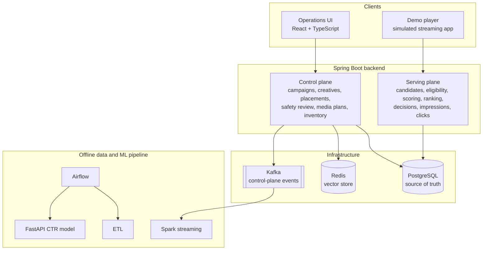
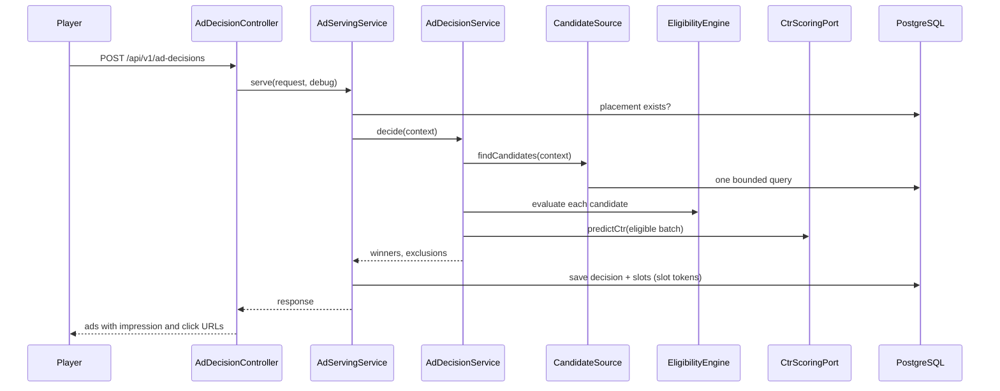
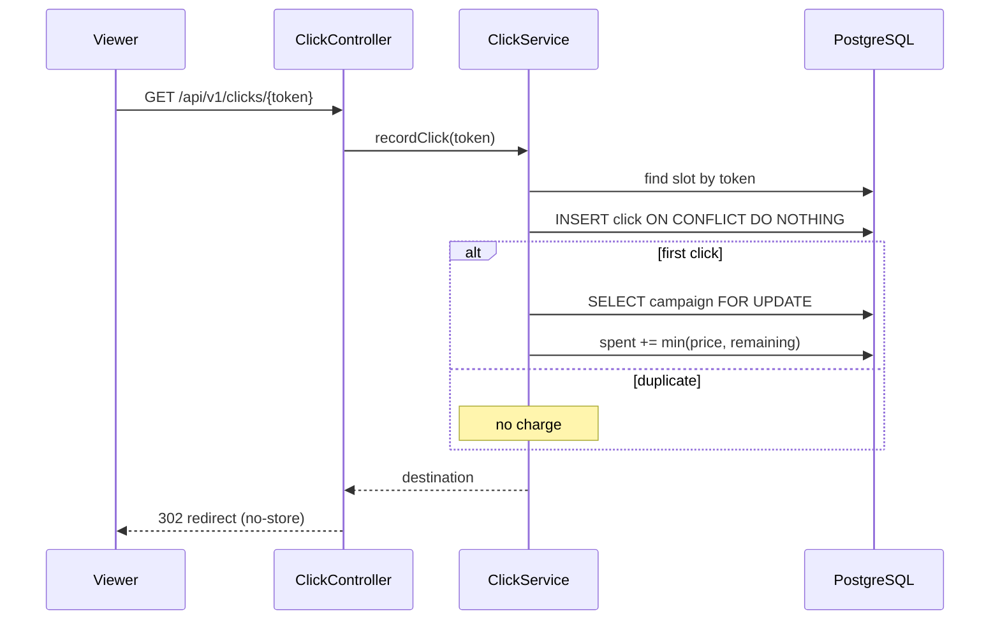
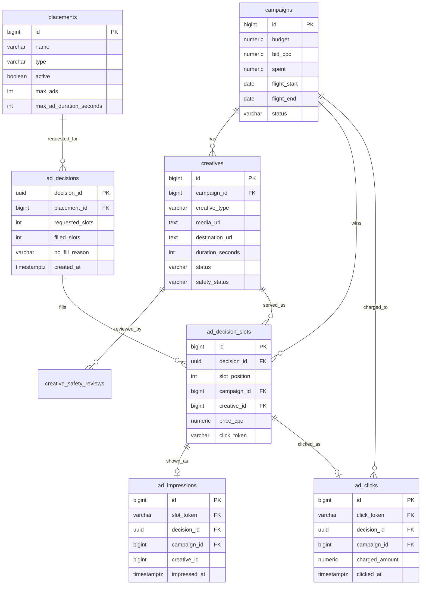

# Architecture

This document describes how the Streaming Ads Platform is put together: the
components, how a request, an impression and a click flow through them, the data
model, the consistency guarantees, and how the design would evolve at scale.

Each section separates what is **built and tested** from what is **designed but
not built yet**.

## 1. System overview



The platform has four planes:

| Plane | Responsibility | Status |
|---|---|---|
| **Control plane** | People configure what is allowed to serve: campaigns, creatives, placements, safety review | Built |
| **Serving plane** | Machines decide, in one request, which ads serve, count them when they appear, and charge for clicks | Built |
| **Measurement plane** | Events flow into analytics, pacing, advertiser stats and training data | Impressions and clicks recorded; serving events to Kafka designed |
| **Offline data and ML** | Batch ETL, stream aggregation, model training | Built in an earlier version, not yet wired into serving |

The backend is a single Spring Boot application with clear package boundaries
per domain. It is not split into microservices: the boundaries (ports such as
`CandidateSource` and `CtrScoringPort`) are where it would split if load
required it.

## 2. Control plane

People use the control plane to define what may serve. Nothing here runs per
ad request.

| Domain | What it holds | Key rules |
|---|---|---|
| **Campaign** | Advertiser deal: budget, bid per click, flight dates, targeting | Spend changed only by click tracking; spend never above budget |
| **Creative** | The ad itself: type, media, destination, duration | Two independent gates: `status` (advertiser) and `safetyStatus` (platform) |
| **Placement** | A platform-owned slot: type, devices, creative types, max ads, max length per ad | Entity enforces all rules; new placements start inactive; unique names |
| **Safety review** | Review history for each creative | Only an approved creative can serve |
| **Media plan, inventory** | Commercial agreements and slot inventory per show | Workflow states for proposals |

Rules live **inside the entities** where possible. For example, `Placement` has
no setters: it can only be created or changed through methods that validate
everything before assigning anything, so every caller (HTTP, tests, future code)
hits the same checks.

## 3. Serving plane: one ad request

### Trace

A TV viewer watching `show-711` reaches a mid-roll break with 2 slots:

```text
POST /api/v1/ad-decisions
  { placementId: 1, deviceType: TV, showId: show-711,
    audienceSegments: [HOME_IMPROVEMENT], availableSlots: 2 }

1. Validate request          400 if malformed; 404 if the placement does not exist
2. Retrieve candidates       one query: ACTIVE campaigns with a bid and
                             budget - spent >= bid, ACTIVE + APPROVED creatives
                             of a type the placement accepts
                             -> campaign 10 + creative 15
3. Eligibility rules         campaign active, in flight, placement and device fit,
                             creative fits (type and length), targeting matches
                             -> eligible
4. Score                     CtrScoringPort, one batch call -> CTR 0.02 (fixed prior)
5. Rank                      bid x CTR = 1.50 x 0.02 = 0.03
6. One per campaign, fill    1 candidate, 2 slots -> 1 slot filled
7. Record                    ad_decisions row + ad_decision_slots row,
                             price 1.50, random slot token
8. Respond                   media URL, impression URL and click URL;
                             no advertiser destination
```

### Sequence



### Components

| Component | Responsibility | Extension point |
|---|---|---|
| `DatabaseCandidateSource` | One bounded query; cheap, certain filters only | `CandidateSource` (a Redis index can replace it) |
| `EligibilityEngine` | Runs every `EligibilityRule` in `@Order` | New rule = new class; engine unchanged |
| `CreativeFit` | Shared type and length check | Used at serving now, at setup time later |
| `PriorCtrScorer` | Fixed prior CTR (0.02) | `CtrScoringPort` (a model client replaces it) |
| `AdDecisionService` | Orchestrates: eligibility, scoring, ranking, one per campaign, slot filling | Pure logic, no writes |
| `AdServingService` | Records the decision, issues slot tokens, builds the response | Separates deciding from recording |

### Design choices

- **Hard rules before scoring.** Scoring is the expensive step; it never runs on
  an ad that is not allowed to serve.
- **Retrieval filters what is cheap and certain; rules decide the rest.**
  Targeting stays in the rules, so exclusions can be explained with reason codes.
- **Loose date filter in retrieval (±1 day)**, exact check in `FlightDateRule`
  with the platform time zone, so the two can never disagree.
- **Deterministic tie-breaking** (lower campaign id, then creative id), so the same
  input always gives the same decision.
- **No-fills are recorded**, so fill rate can be measured.
- **Prices and exclusions only in debug mode**: other advertisers' bids are
  commercially sensitive.
- **One token per slot** identifies the served ad for both its impression and its
  click, so the two can be joined per slot.

## 4. Serving plane: one impression

A decision means an ad was chosen. It may still never appear: the viewer can
leave, or the media can fail to load. The player reports when the ad actually
appears.

### Trace

```text
The image finishes loading (onLoad) or the video starts playing (onPlaying)
POST /api/v1/impressions/du7kLg...

1. Find the slot by token          unknown -> 404
2. Token older than 24 hours?      ignored, not recorded
3. Record                          INSERT ... ON CONFLICT (slot_token) DO NOTHING
                                   0 rows -> duplicate, ignored
4. 204 No Content
```

### Design choices

- **Shown, not chosen.** The player reports only when the media is really on
  screen. A placeholder shown because the media failed is not an impression.
- **Once per slot**, guaranteed by a unique constraint. Retries and double
  reports (React deliberately runs some effects twice in development) are
  harmless.
- **Best-effort reporting.** A failed impression report never interrupts the ad.
  Losing one measurement is better than breaking playback.
- **Not billed.** Billing is per click; impressions are measured for CTR and
  advertiser stats.
- **Clicks without a recorded impression can exist** (a player that failed to
  report), so stats must not assume every click has an impression.
- **Designed:** viewability for scrolling placements, using the common industry
  definition (at least 50% of a display ad on screen for at least 1 second; 2
  seconds for video).

## 5. Serving plane: one click

### Trace

```text
GET /api/v1/clicks/du7kLg...

1. Find the slot by token          unknown -> 404, nothing charged
2. Token older than 24 hours?      redirect without charging or recording
3. Claim the click                 INSERT ... ON CONFLICT (click_token) DO NOTHING
                                   0 rows -> duplicate: redirect, no charge
4. Charge                          lock campaign row (SELECT ... FOR UPDATE)
                                   charged = min(price, budget - spent)
                                   spent += charged
5. Record charged amount
6. 302 to the creative's stored destination, Cache-Control: no-store
```

### Sequence



## 6. Consistency and concurrency

| Guarantee | Mechanism | Verified by |
|---|---|---|
| A click is charged once, even if two copies arrive at the same moment | Unique `click_token` + `INSERT ... ON CONFLICT DO NOTHING`: the check and the claim are one statement | Concurrency test: same token, two threads |
| Concurrent clicks never push spend past budget | Campaign row lock (`PESSIMISTIC_WRITE`) during charging; charge capped at what is left | Concurrency test: $1.60 left, two $1.50 clicks, spend lands exactly on budget |
| Spend never exceeds budget even if code has a bug | `CHECK (spent <= budget)` | Database constraint |
| An impression is counted once per served ad | Unique `slot_token` + `INSERT ... ON CONFLICT DO NOTHING` | Unit tests + constraint |
| One ad per campaign per decision | Ranking logic + `UNIQUE (decision_id, campaign_id)` | Unit test + constraint |
| Unique placement names under concurrent creates | Service check for a clear message + unique index on `LOWER(name)`; SQL state 23505 mapped to 409 | Unit and controller tests |
| No deadlocks between clicks | Every click takes locks in the same order: claim the click, then lock the campaign | Design |
| The charged price is the auction price | `price_cpc` stored per slot at decision time | Design + tests |

Why database locks and not Java locks: `synchronized` only protects one
instance. Database row locks hold across any number of application instances.

## 7. Data model



`ad_impressions` is indexed on `(campaign_id, impressed_at)`, matching how
advertiser stats read it: one campaign over a date range.

Supporting tables (not shown): placement supported devices and creative types,
campaign targeting (shows, segments, placements, devices), media plans,
inventory, legacy safety flags, aggregated metrics.

Schema changes go through **Flyway migrations V1 to V12**, applied once each, in
order. Applied migrations are never edited; changes always go in a new migration.

## 8. Failure handling

| Failure | Behavior | Status |
|---|---|---|
| Malformed request | 400 with a field-level message | Built |
| Unknown placement | 404, nothing recorded | Built |
| No eligible ads | 200 with empty ads and a no-fill reason; decision recorded | Built |
| A bad database row | That candidate is skipped and logged; others still serve | Built |
| Ad media fails to load | Player shows a placeholder; no impression reported | Built |
| Impression report fails | Ignored by the player; the ad keeps playing | Built |
| Unknown impression or click token | 404, nothing recorded or charged | Built |
| Expired token | Impression ignored; click redirected without charging | Built |
| Budget exhausted at click time | Click recorded, charged 0; campaign stops being retrieved | Built |
| Duplicate-name race | 409 from the database constraint | Built |
| Scoring service slow or down | Fall back to the prior CTR within a timeout | Designed (needed once a remote model exists) |
| Event publishing fails after a commit | Transactional outbox | Designed |

## 9. Security

- **Unguessable slot tokens:** 32 random bytes from `SecureRandom`, URL-safe.
  Sequential tokens would let anyone fake clicks and charge advertisers.
- **No open redirect:** the click redirect target comes from the stored creative,
  never from the request.
- **Redirects are never cached** (`no-store`), so every click passes through tracking.
- **Advertiser destinations are not returned to players**, so clicks cannot
  bypass tracking.
- **One impression per token**, so a leaked token cannot inflate an advertiser's
  impression count.
- **Secrets come from environment variables** (for example `OPENAI_API_KEY`);
  the committed config holds only local Docker credentials.
- **Designed:** partner API keys and per-partner rate limits for third-party callers.

## 10. Scaling path

The current design is correct first and simple second. Each step below is
added when measurement shows it is needed, not before.

| Today | At scale | Trigger |
|---|---|---|
| Candidate query against PostgreSQL | Precomputed candidate index in Redis behind `CandidateSource` | Retrieval latency under load |
| Spend charged in PostgreSQL with row locks | Atomic Redis counters, reconciled with PostgreSQL | Lock contention on hot campaigns |
| Single application instance | Stateless serving instances behind a load balancer | Request volume |
| Fixed prior CTR | Model service behind `CtrScoringPort`, batch scoring, timeout and fallback | Enough impression and click history |
| Impressions and clicks queried from raw tables | Daily rollups for advertiser stats, reconciled with billed spend | Reporting volume |
| Decisions, impressions and clicks only in PostgreSQL | Typed events to Kafka via a transactional outbox, then Spark aggregation | Analytics and pacing needs |
| Flight dates in one platform time zone | Per-campaign zone, with an opt-in viewer-local mode | Multi-region campaigns |

Serving instances hold no state between requests, so they scale horizontally.
PostgreSQL remains the source of truth throughout; Redis and Kafka are added as
optimizations and transport, never as the authority.

## 11. Observability

**Today:** structured application logs, and every decision recorded with its
reason codes, which is enough to answer "why did or didn't this ad serve?"
Impressions and clicks are recorded per slot, so served, shown and clicked can
be compared for any campaign.

**Designed:** metrics for decision latency, candidate count, fill rate, scorer
fallback rate, impression report rate, duplicate click rate and spend per
campaign, with dashboards and alerts.

## 12. Project structure

```text
.
├── README.md
├── docs/
│   └── ARCHITECTURE.md
├── ads-platform/                          Spring Boot backend
│   ├── docker-compose.yml                 PostgreSQL, Redis, Kafka, ZooKeeper, Airflow
│   ├── pom.xml
│   └── src/
│       ├── main/java/com/adsplatform/
│       │   ├── AdsPlatformApplication.java
│       │   ├── campaign/                  Campaign entity, service, controller, repository
│       │   ├── creative/                  Creative entity, statuses, service, controller, DTOs
│       │   ├── placement/                 Placement entity (rules inside), service, controller, DTOs
│       │   ├── safety/                    Creative safety review; legacy vector-based flags
│       │   ├── mediaplan/                 Media plan workflow
│       │   ├── inventory/                 Show inventory
│       │   ├── kafka/                     Control-plane event consumers
│       │   ├── config/                    Infrastructure configuration, Clock bean
│       │   ├── common/                    ApiResponse, exceptions, global exception handler
│       │   └── serving/
│       │       ├── model/                 AdRequestContext, CandidateAd snapshots
│       │       ├── candidate/             CandidateSource, DatabaseCandidateSource
│       │       ├── eligibility/           EligibilityEngine, rules, reason codes, CreativeFit
│       │       ├── scoring/               CtrScoringPort, PriorCtrScorer
│       │       ├── decision/              Decision logic, recording, entities, controller, DTOs
│       │       ├── impression/            Impression tracking: service, controller, entity
│       │       └── click/                 Click tracking: service, controller, entity
│       ├── main/resources/
│       │   ├── application.yaml
│       │   └── db/migration/              Flyway migrations V1 to V12
│       └── test/java/com/adsplatform/     Unit, controller and integration tests
├── ads-platform-ui/                       React + TypeScript
│   ├── public/                            Static files, including demo ad media
│   └── src/
│       ├── api/                           API client and endpoint functions
│       ├── components/                    Shared components; player/ for the demo player
│       ├── pages/                         One page per screen, including DemoPlayerPage
│       ├── types/                         Shared types, including the decision contract
│       └── utils/                         Shared form logic
└── big-data-python/                       Offline pipeline
    ├── etl_pipeline.py                    Dataset load and aggregation
    ├── spark_pipeline.py                  Structured streaming aggregation
    ├── ml_scoring_service.py              FastAPI CTR model (train, predict)
    ├── dags/                              Airflow DAG
    └── requirements.txt
```

## 13. Status summary

| Area | Built and tested | Designed, next |
|---|---|---|
| Control plane | Campaigns, creatives, placements, safety review, media plans, inventory | Placement and device pairs for targeting; per-campaign time zones |
| Serving | Retrieval, eligibility, scoring interface, ranking, slot filling, decision records, endpoint | Real CTR model; second-price pricing for multiple slots |
| Impressions | Recorded once per served ad, only when the ad really appears | Viewability for scrolling placements |
| Clicks | Idempotent, budget-safe charging with concurrency tests | Fraud signals; partner attribution |
| Conversions and stats | (not yet) | Conversion postback with cancellations; advertiser stats with daily rollups reconciled to billing |
| Measurement | Control-plane events in Kafka | Typed serving events via outbox; Spark aggregation |
| Offline ML | Earlier ETL, Spark, Airflow and FastAPI model on a public dataset | Training on the platform's own events; model versioning |
| Platform | Flyway migrations, global error handling | Partner API keys, rate limiting, metrics and dashboards |